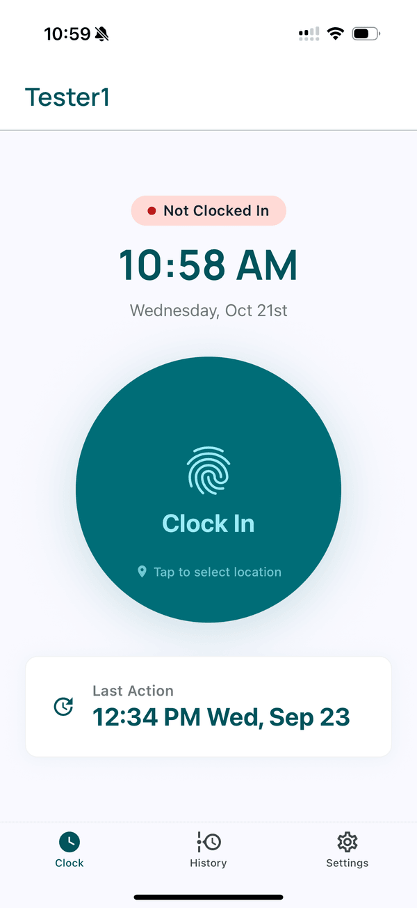
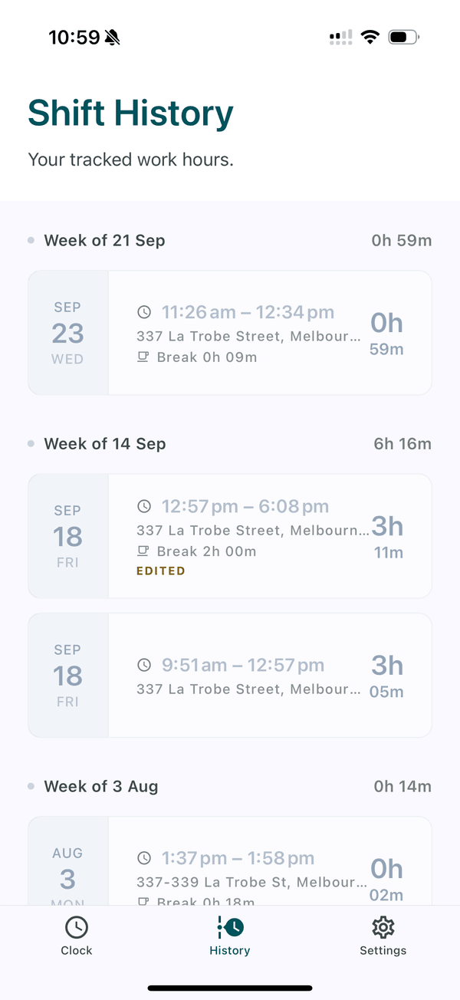
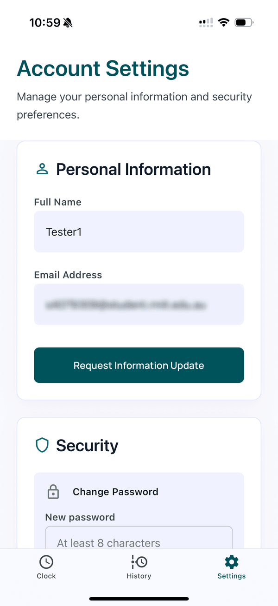
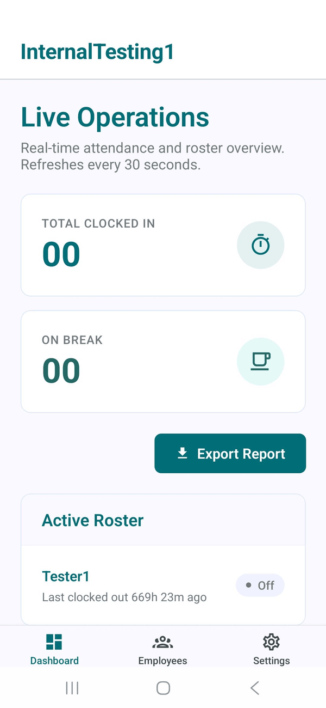
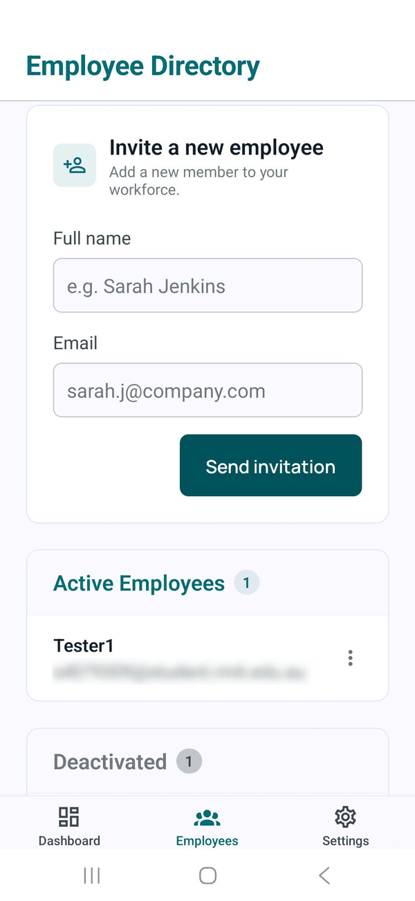
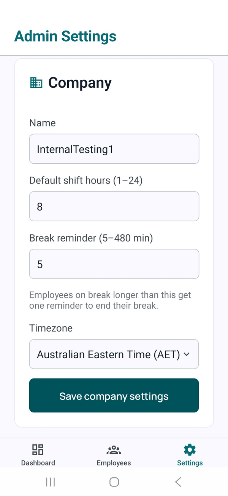

<p align="center">
  
</p>

<h1 align="center">Tapp</h1>

<p align="center">
  <b>A location-verified clock-in/out app for small teams that work across multiple sites.</b><br/>
  iOS · Android · Expo + React Native + Supabase
</p>

<p align="center">
  <a href="https://tappclock.com">tappclock.com</a>
</p>

---

## What it is

Tapp replaces paper timesheets and "I forgot to clock out" texts for small
businesses (10–20 staff) whose people move between job sites during the day:
trades, cleaning crews, field services.

- **Employees** clock in and out from their phone at the address they're
  working at. The app checks they're physically there.
- **Admins** see who's on the clock right now, fix mistakes, and export a
  payroll-ready CSV.

One app binary serves both roles. The user's role, set at login, decides which
UI loads.

It's a working product, not a demo. The backend is deployed on hosted
Supabase, the app runs on real iOS and Android devices, and companies sign
up through the public website.

## Screenshots

**Employee (iOS)**: clock in, shift history, account settings

<p>
  
  
  
</p>

**Admin (Android)**: live dashboard, employee directory, company settings

<p>
  
  
  
</p>

## Features

### For employees
- **One-tap clock in/out**, with a geofence check against the worksite
  address (default 50 m radius, configurable per company)
- **Address autofill** from GPS, plus a list of recent worksites
- **Breaks**: start/end a break while on the clock. Clock-out is blocked
  while a break is open.
- **Multi-site days**: each site gets its own entry. Travel time between
  sites is calculated, not entered by hand.
- **History** of past shifts, with an *Edited* badge on any entry an admin
  changed
- **Push reminders**: "Still clocked in?" after a shift runs long, and a
  nudge when a break overruns

### For admins
- **Live dashboard** of every employee's status (Off / Clocked in at *X* /
  On break). Shifts open for more than 12 hours are flagged.
- **Edit or delete past entries**, including their breaks. Each save is
  applied in a single database transaction, and every edit records who made
  it and why.
- **Clock an employee in on their behalf** when someone's phone dies
- **Invite employees** by email. They set their own password from the link.
- **Reactivate or delete** employee accounts
- **CSV timesheet export** by date range and employee. Shows hours worked,
  break minutes, net hours, travel minutes between sites and per-employee
  summary rows. Dates are bucketed in the company's own timezone and the
  file opens cleanly in Excel.
- **Company settings**: geofence radius, shift length before reminders,
  break reminder threshold

## Architecture

```
┌─────────────────────────────┐        ┌──────────────────────────┐
│  Expo app (iOS + Android)   │        │  tappclock.com           │
│  Employee UI / Admin UI     │        │  (Cloudflare Pages)      │
│  chosen by role at login    │        │  signup, invite and      │
└──────────────┬──────────────┘        │  password-reset links    │
               │ supabase-js (HTTPS)   └────────────┬─────────────┘
               ▼                                    ▼
┌─────────────────────────────────────────────────────────────────┐
│                            Supabase                             │
│  Postgres + Row-Level Security   ·   Auth   ·   Storage (CSVs)  │
│  Triggers: geofence check, server timestamps, break auto-close  │
│  pg_cron (every minute) ──► Edge Functions (Deno/TypeScript)    │
└──────────────────────────────┬──────────────────────────────────┘
                               ▼
                 Expo Push Service ──► APNs / FCM
```

Most traffic goes straight from the app to Postgres, and **Row-Level Security
is the security boundary**. There is no custom API layer to keep in sync.
Edge Functions are used only where the server must be trusted: sending push
notifications, generating CSVs, sending invite emails and creating companies.

### Engineering decisions worth calling out

| Decision | Why |
|---|---|
| **Multi-tenant from day one.** Every table has a `company_id` and an RLS policy. | Launched with one company, but a second one needs no migration. pgTAP tests check that one company cannot read or write another company's rows. |
| **Geofence enforced in Postgres**, not only in the app | The client-side check is just for a friendly error message. A Postgres trigger checks the distance again on every insert/update, so a modified client can't clock in from home. |
| **Server-issued timestamps** (`now()` in a trigger) | Clock-in times can't be faked by changing the phone's clock. |
| **One row per clock-in/out cycle.** Travel time is derived. | Multi-site days need no special handling. Travel is the gap between same-day rows, calculated at export time. |
| **30-second polling** instead of websockets for the admin dashboard | Fresh enough for the job, and simpler to build and run. |
| **Reminders scheduled by `pg_cron`** inside the database | The schedule lives next to the data, so there's no separate job service to host. |
| **HTTPS landing page in front of `tapp://` deep links** | Gmail and Outlook on iOS silently disable custom-scheme links in emails. Invite and reset emails link to `tappclock.com`, which then opens the app. |

### Production bugs found and fixed

- **A break left open was paid as work time.** If an admin closed a shift
  while a break was still open, the break was never closed and payroll
  counted it as zero minutes. The fix closes the break inside the existing
  timestamp trigger. That trigger re-enters itself, so the fix uses a
  transaction-scoped session flag instead of a role check.
- **Clock-out reminders had never been delivered in production.** Smoke-testing
  turned up five separate bugs: an API key mismatch between cron and the Edge
  Function, no foreground notification handler, push tokens leaking between
  accounts on a shared phone, a permission prompt that was never shown, and
  registration errors that were silently swallowed. I found them by reading
  `net._http_response`, the only place `pg_net` keeps the function's replies.
- **Invited employees could turn themselves into admins of junk companies** by
  tapping "Create company" before accepting their invite. Fixed by design:
  company signup moved to the website, and the app became login and invite
  only.

## Tech stack

| Layer | Tools |
|---|---|
| Mobile | Expo SDK 54, React Native 0.81, TypeScript, Expo Router |
| State and data | TanStack Query (server state, polling), Zustand (client state) |
| Forms | react-hook-form + zod |
| Styling | NativeWind (Tailwind for React Native), Manrope, custom design tokens |
| Backend | Supabase: Postgres, Auth, Storage, Edge Functions (Deno), `pg_cron`, `pg_net`, Vault |
| Email | Resend, from a verified domain (DKIM + SPF) |
| Web | Static site on Cloudflare Pages (marketing page, company signup, deep-link redirects) |
| Delivery | EAS Build (native builds) + EAS Update (over-the-air JS updates) |
| Testing | pgTAP (database), Jest (app logic), manual smoke checklists per feature |

## Testing

- **Database: 16 pgTAP suites.**
  They cover tenant isolation under RLS (including attempts to move a row to
  another company via UPDATE), unique constraints (only one open shift and one
  open break at a time), the geofence trigger, server timestamps, the
  signup trigger, break auto-close, break reminders and the admin
  entry-editing functions.
- **App: Jest unit tests** for geofence maths, CSV
  generation and timesheet summary rows, break validation and diffing,
  recovery-link parsing, reminder messages and admin clock-in rules.
- **Smoke checklists** for every feature, run on real devices with real GPS,
  push and geocoding.

## Project structure (private repository)

```
app/                  Expo Router screens
  (auth)/             login, accept-invite, forgot/reset password
  (employee)/         clock, history, settings
  (admin)/            dashboard, employees, employee-entries, edit-entry,
                      clock-in-employee, export, settings
src/
  components/         UI components grouped by feature
  hooks/              TanStack Query hooks (one per resource or mutation)
  lib/                supabase client, geofence, geocoding, push, CSV helpers
supabase/
  migrations/         23 SQL migrations: schema, RLS, triggers, cron jobs
  functions/          7 Edge Functions (invite, accept, create-company,
                      export-timesheet, delete-employee, two reminder senders)
  tests/              pgTAP suites
invite-landing/       tappclock.com static site
docs/                 specs, implementation plans, runbooks, smoke tests
```

## How it was built

The project followed a written process: a design spec first, then
step-by-step implementation plans, then code. Every later feature (password
recovery, admin clock-in, break reminders, configurable geofence and others)
has its own design doc, and the architecture spec covers the schema, security
rules, core flows, error handling and testing strategy.

Some features were left out on purpose (offline mode, shift scheduling,
overtime rules, approval workflows). The spec records why each was deferred.

## Source code

This repository is a showcase. The source code is kept in a private
repository because Tapp is a live product.

**[Code samples →](code-samples/)** A selection of files copied unedited
from the private repository: the security policies and their tests, the
geofence trigger, the payroll bug fix, the timesheet export function and the
main clock-in screen. Each comes with a note on what to look at.

I'm happy to walk through the rest of the code or grant read access on
request.
